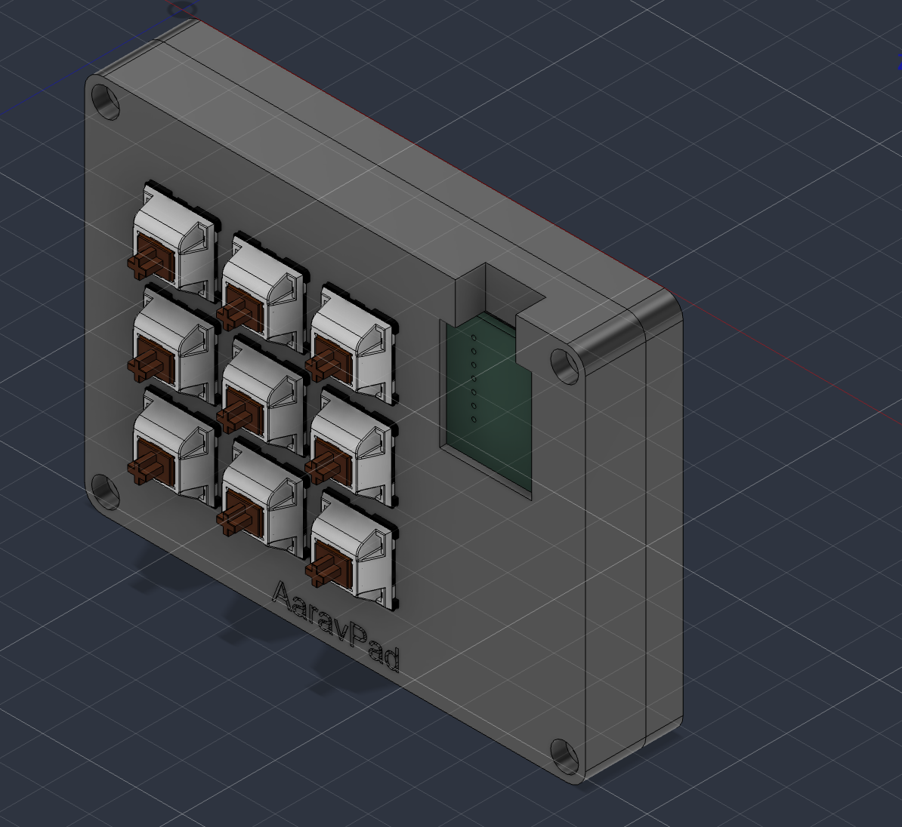
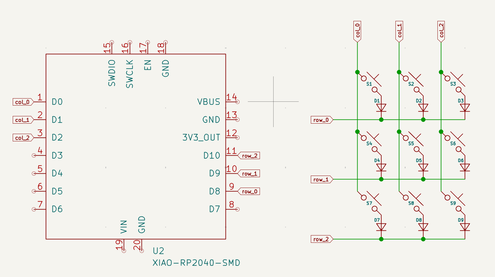
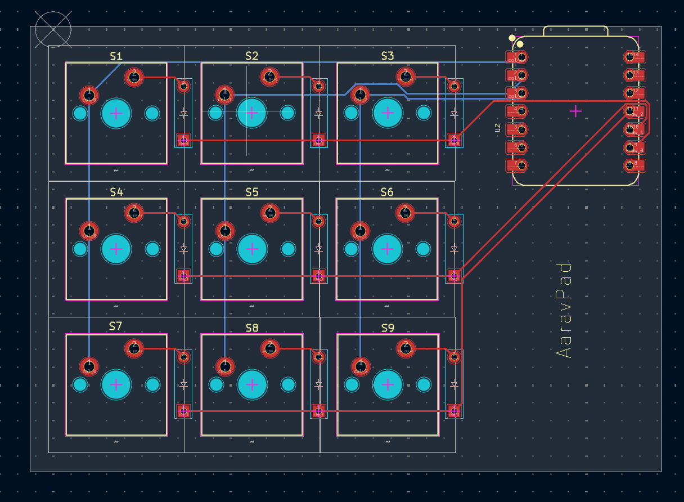
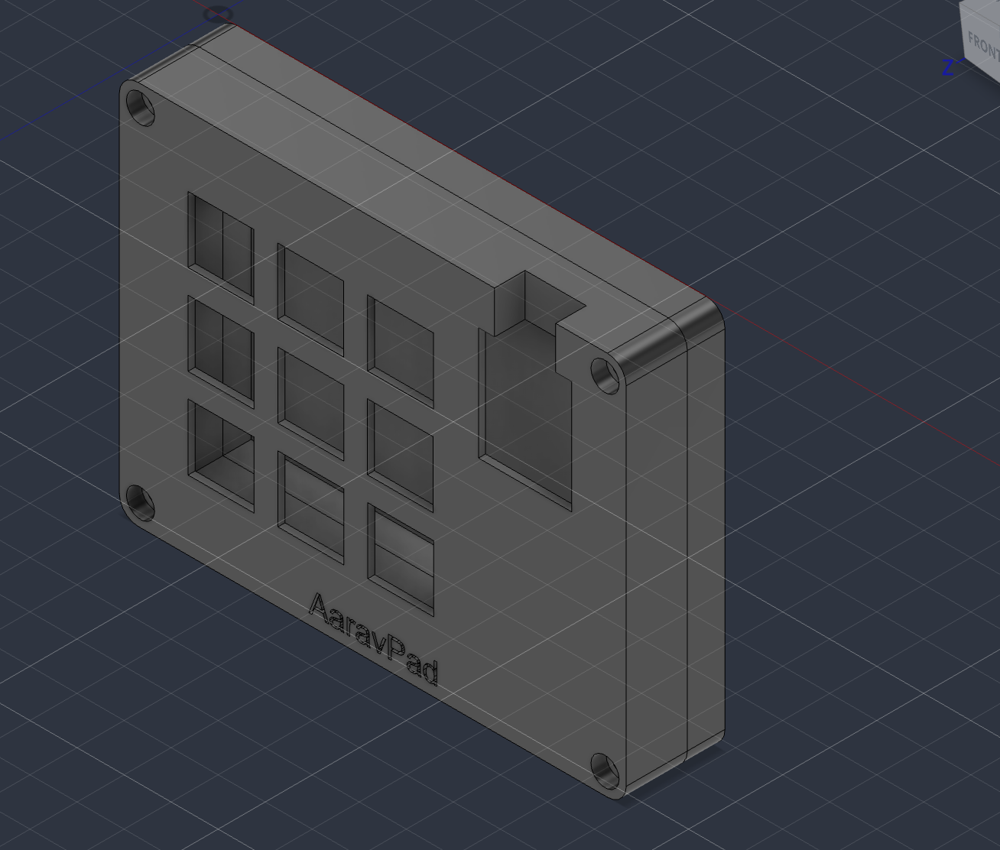

# AaravPad

A 3x3 macropad I made for Hackpad. 9 keys, a XIAO RP2040, running KMK.

## Why

I wanted to make something start to finish myself: PCB, case, firmware, all of it. A macropad seemed like a good first project, and it's something I'll actually use.

## What went wrong

- I built the first version around a Pro Micro before realising it isn't on the approved parts list, so I had to swap it for the XIAO and redo the wiring.
- The USB port was sitting way inside the board, so you couldn't plug a cable in once it was in the case. I had to move it to the edge and resize the board.
- Getting the 3D models to show up in KiCad took way longer than it should have.

## Schematic

## PCB

2 layer board, around 89 x 63 mm.

## Case

Two printed parts, a top plate and a bottom tray. The switches clip into the plate, the PCB gets soldered to them, and 4 M3 screws go through the top into heat-set inserts in the bottom.

## BOM

- 1x Seeed XIAO RP2040
- 9x MX switches
- 9x 1N4148 diodes
- 9x DSA keycaps
- 4x M3x16 screws
- 4x M3 heat-set inserts
- 1x PCB
- 3D printed case (top + bottom)
